<p align="center">
  
</p>

<h1 align="center">Signal · 漏洞信号台</h1>

<p align="center">
  <strong>把主机与组件的漏洞信号，变成可执行、可追溯的处置动作。</strong>
</p>

<p align="center">
  
  
  
  
  
  
</p>

<p align="center">
  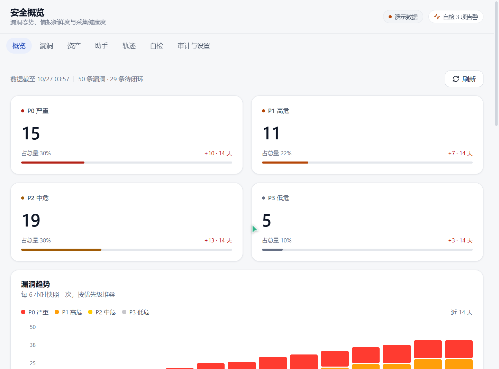
</p>

Signal 是一个面向主机与软件组件的**漏洞运营控制面**：Agent 采集 SBOM 与运行遥测，控制面完成 CVE/EPSS/KEV/OSV 匹配、可解释的风险排序、工单闭环与复扫验证；在此之上提供受控的 Agent 助手，把「看数据」延伸到「安全地做操作」。

- **单二进制交付**：Go 编译产物内含控制面、采集器、Agent、CLI 与迁移脚本，前端构建产物由同一进程托管。
- **可解释的风险排序**：CVSS × EPSS × 在野利用 × 资产权重，每一分都能在详情页拆解。
- **默认安全**：写操作必须经过会话审批模式与多重闸门，高风险再认证，一次性审批按参数指纹绑定，全程留痕。
- **能落地的助手**：32 个静态注册工具 + `/` 技能调用，只读诊断直接执行，变更操作走审批。

---

## 目录

- [界面预览](#界面预览)
- [核心能力](#核心能力)
- [架构](#架构)
- [快速开始](#快速开始)
- [配置](#配置)
- [受控执行与安全模型](#受控执行与安全模型)
- [SSH 智能终端](#ssh-智能终端)
- [运维技能](#运维技能)
- [目录结构](#目录结构)
- [测试与质量](#测试与质量)
- [部署](#部署)
- [文档](#文档)
- [许可证](#许可证)
- [已知边界](#已知边界)

---

## 界面预览

> 概览、漏洞、资产、助手截图使用演示数据（`VA_SEED_DEMO=on`）；自检与审计截图来自本机真实运行数据；SSH 终端截图连接的是本地测试 SSH 服务。截图中的「演示数据」标识会随模式自动出现/隐藏。

**安全概览**：P0–P3 分布、14 天趋势、情报新鲜度与采集健康度一屏可见。


**漏洞清单**：按风险分排序，优先级、组件、修复版本、状态与责任人同屏；支持搜索、优先级/状态筛选与 CSV/PDF 导出。

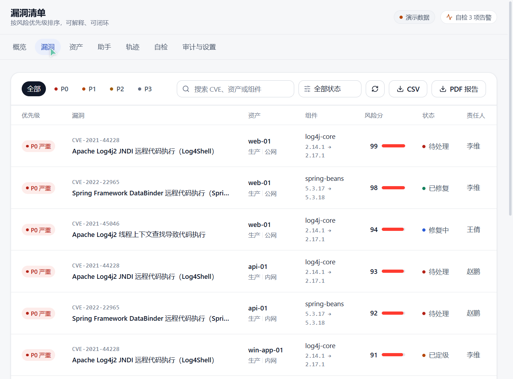

**资产详情**：主机画像、暴露面与组件清单，CPE 映射与关联漏洞逐项可查。

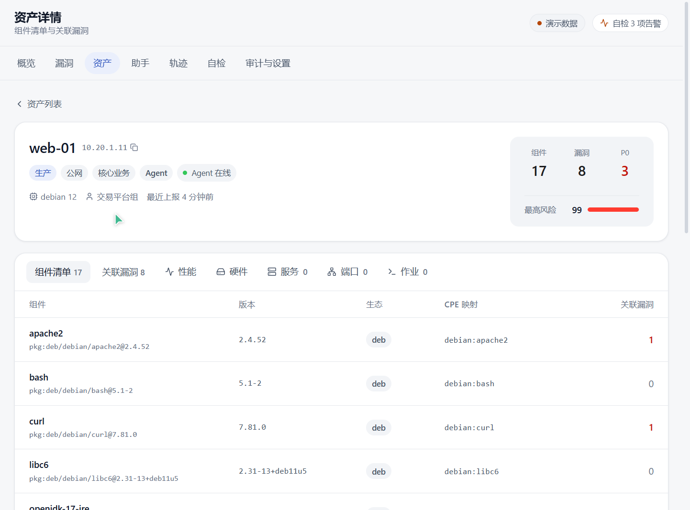

**Agent 助手**：工具调用自动聚合折叠，回答带引用依据；输入 `/` 可调用运维技能，写操作在输入框上方审批。

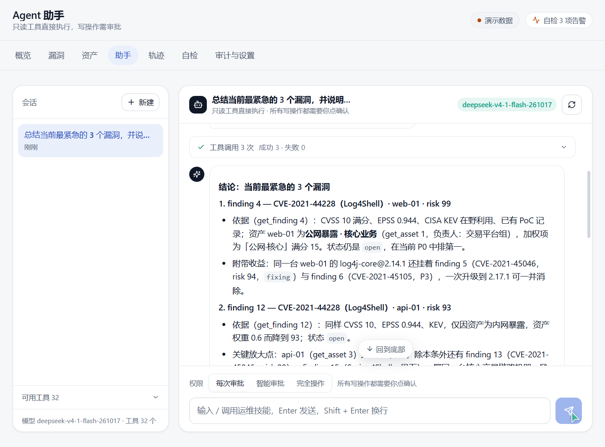

**SSH 智能终端**：多标签会话直连远端 PTY，连接状态、主机指纹与会话号一栏可见。

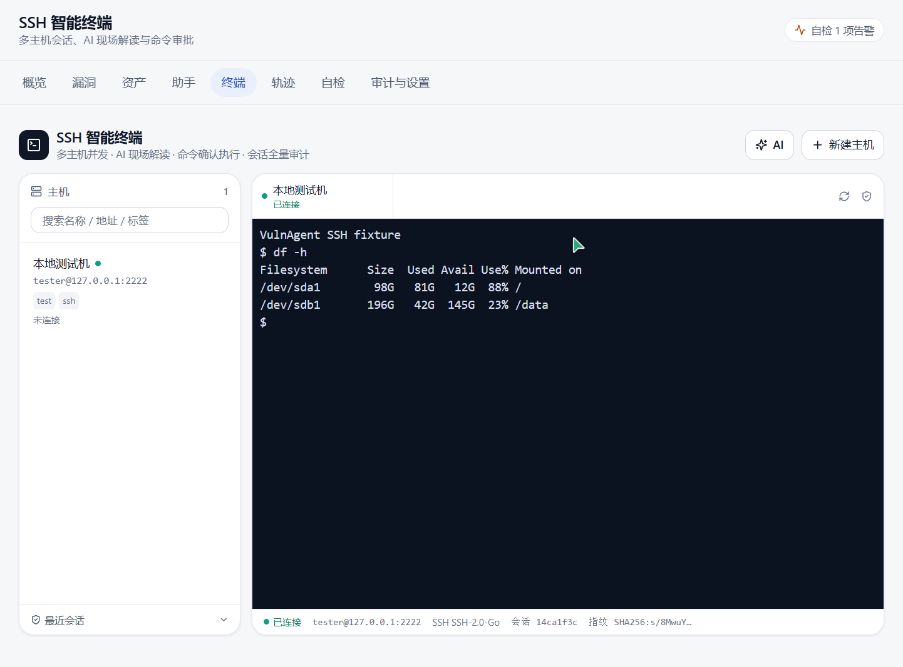

**AI 终端助手**：读取最近终端输出并结合主机信息回答，生成的命令默认只插入，执行前需要二次确认。

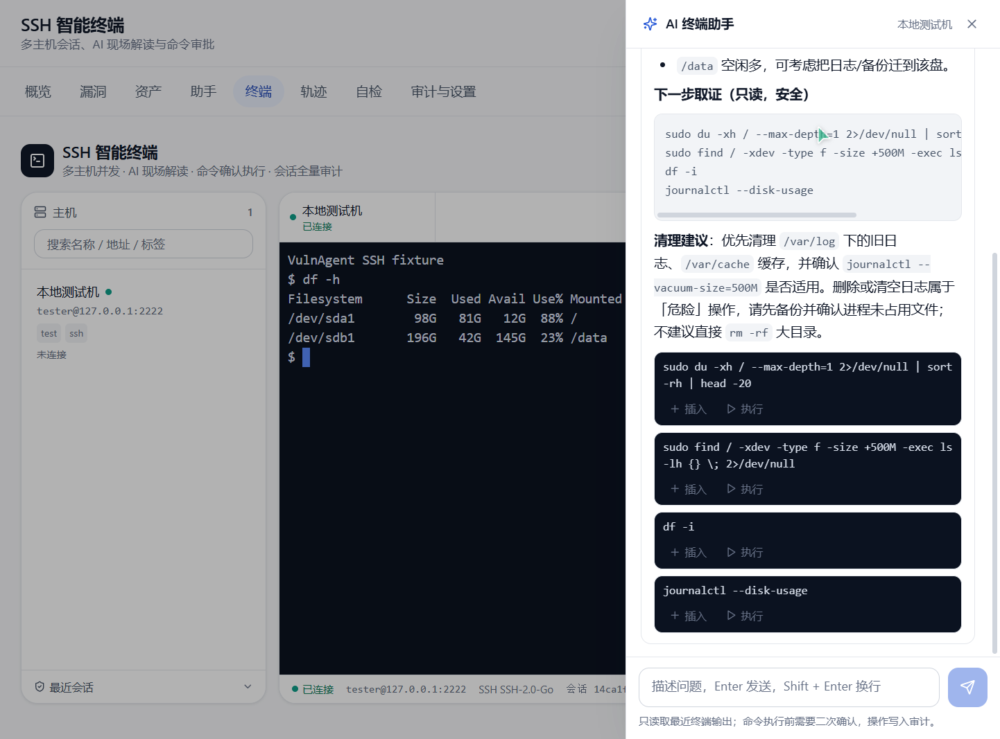

**Agent 自动执行**：目标被拆解为多步命令，逐步读取输出继续推理；危险命令按模式暂停等待人工确认。

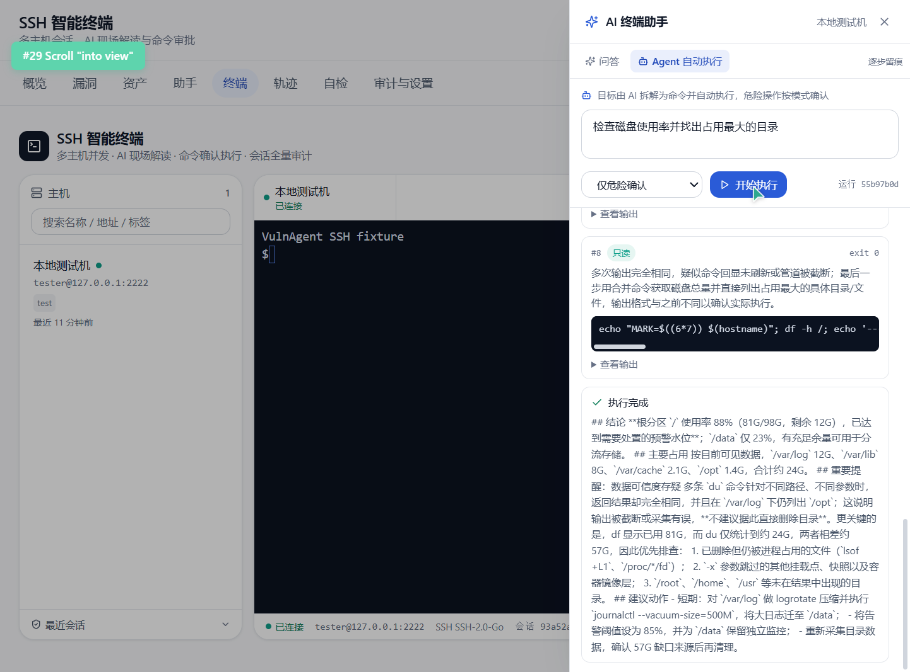

**Agent 命令审批**：逐条确认模式下，每条命令执行前都等待批准，批准后继续并展示输出与退出码。

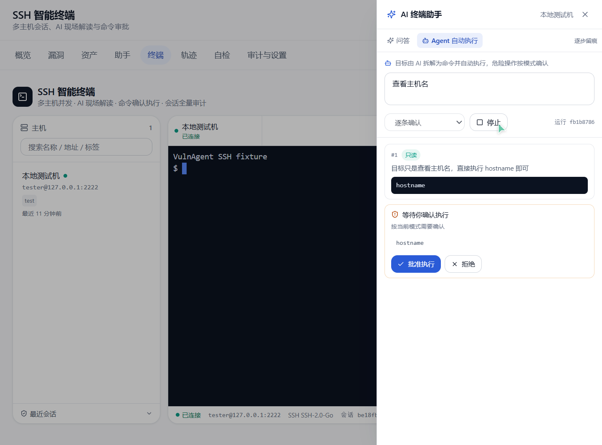

**平台自检**：数据库、情报同步、采集链路与平台自身共 16 项检查，失败项给出可执行建议。

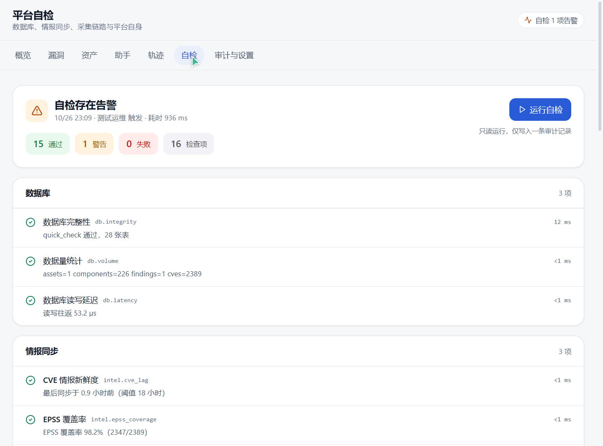

**审计日志**：支持关键字、操作人、动作与时间范围筛选，登录、扫描、导出、策略调整与审批全部留痕。

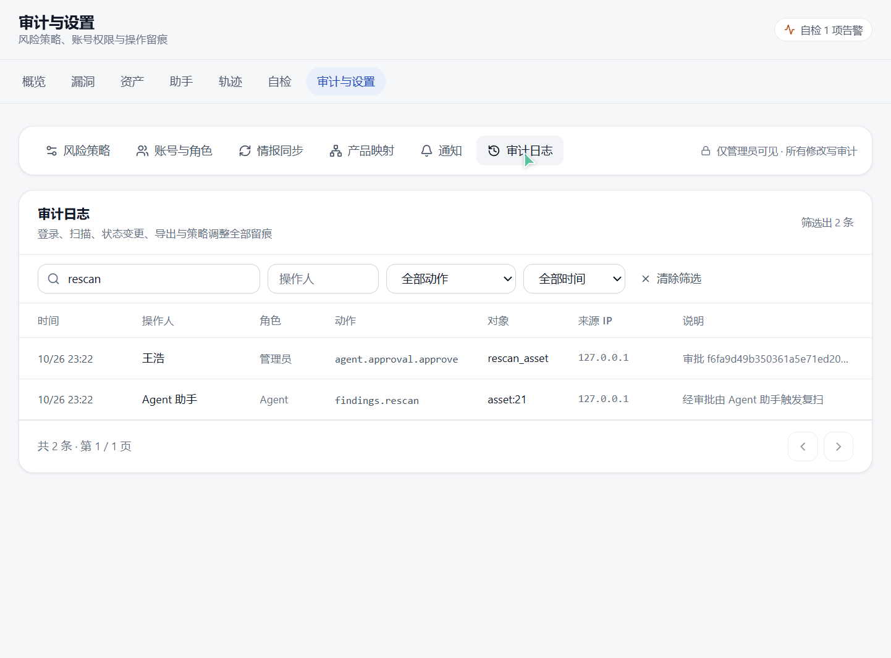

---

## 核心能力

| 能力 | 说明 |
| --- | --- |
| 资产与 SBOM | Windows（注册表 / CIM）与 Linux（dpkg / rpm / 语言生态）采集，覆盖系统包与 npm、pip、maven 等语言依赖 |
| 漏洞匹配 | CVE 库 + OSV 在线精确版本匹配 + 内置产品映射；无法安装 Agent 时可用 SSH 只读兜底采集 |
| 风险排序 | CVSS、EPSS、CISA KEV、POC、资产暴露面与业务权重加权，输出风险分与 P0–P3 |
| 处置闭环 | 状态流转、责任人、本地工单、复扫验证（升级到修复版本自动转「已验证」） |
| 情报同步 | CVE/POC 默认每 12 小时增量同步；EPSS 支持全量导入与在线刷新；自检阈值随同步周期联动 |
| 主机遥测 | CPU、内存、磁盘、网络、负载、进程数，内存占用 Top10 进程，硬件/服务/端口清单 |
| 主机作业 | Agent 拉取模型、HMAC-SHA256 签名、幂等键、指数退避、同资产并发闸门 |
| Agent 助手 | OpenAI 兼容模型接入，SSE 流式返回，32 个静态工具按角色裁剪 |
| SSH 智能终端 | 多主机会话、AES-256-GCM 加密凭据、TOFU 指纹校验、WebSocket 终端、AI 问答与 Agent 自动执行 |
| 运维技能 | `skill/*.zip` 启动解压，`/` 菜单调用，技能文档分页读取，语义化主机诊断 |
| 审计与轨迹 | 审计日志多维筛选；轨迹页统一呈现审计、主机作业与工具调用 |
| 通知 | 飞书 Webhook，支持新漏洞、建单、同步失败、自检失败等事件 |

---

## 架构

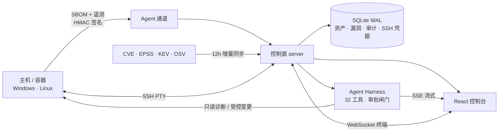

服务端按 DDD 四层组织，`package main` 只做组装：

| 层 | 职责 |
| --- | --- |
| `internal/domain` | 资产、漏洞、风险、身份、Harness 等领域模型与策略 |
| `internal/application` | 用例、仓储端口、扫描流程与 Agent Harness |
| `internal/infrastructure` | SQLite 仓储、OpenAI 兼容模型、SSH 扫描等实现 |
| `internal/platform` | 配置（`.env` 自动加载）、时钟等平台能力 |

---

## 快速开始

**前置**：Go 1.26+、Node.js 20+（仅前端开发需要）。

```powershell
# 1) 构建控制面（Windows；Linux/macOS 将输出名换成 vulnagent 即可）
cd server
go build -o bin\vulnagent.exe .

# 2) 准备配置：程序会自动加载当前目录或上级目录的 .env
#    生产模式至少设置 VA_ADMIN_PASSWORD；演示模式可跳过
Copy-Item ..\deploy\systemd\server.env.example ..\.env

# 3) 启动控制面（默认 :8787）
.\bin\vulnagent.exe server
```

打开 <http://127.0.0.1:8787/>，用初始化时设置的管理员账号登录。

**接入主机 Agent**（采集 SBOM、遥测并执行主机作业）：

```powershell
.\bin\vulnagent.exe agent --server http://127.0.0.1:8787 --watch --interval 5s
```

令牌来源优先级：`--token` > `--token-file` > `VA_AGENT_TOKEN` > `<数据目录>/agent.token`。

**前端开发**：

```powershell
cd web
npm install
npm run dev      # http://localhost:5173，/api 代理到 127.0.0.1:8787
npm run build    # tsc --noEmit + vite build，产物在 web/dist
```

**演示模式**：设置 `VA_SEED_DEMO=on` 会灌入 12 台资产、29 条 CVE 与 50 条漏洞，并创建三个演示账号（仅限本地体验，请勿用于生产）：

| 账号 | 口令 | 角色 |
| --- | --- | --- |
| `admin` | `Admin@12345` | 管理员 |
| `operator` | `Ops@12345` | 运维 |
| `viewer` | `View@12345` | 只读 |

---

## 配置

配置全部来自环境变量，已存在的环境变量优先于 `.env` 文件。

| 变量 | 默认值 | 说明 |
| --- | --- | --- |
| `VA_ADDR` | `:8787` | 控制面监听地址 |
| `VA_DATA_DIR` | `./data` | 数据目录：SQLite、Agent 令牌、备份 |
| `VA_SEED_DEMO` | `off` | `on` 时灌入演示数据并创建演示账号 |
| `VA_ADMIN_PASSWORD` | — | 生产模式首次启动初始化 admin 的口令（≥10 位，含字母与数字） |
| `VA_AGENT_TOKEN` | 自动生成 | Agent 接入令牌；缺省时生成并写入 `<数据目录>/agent.token` |
| `VA_SSH_KEY` | 自动生成 | SSH 凭据加密密钥（32 字节 base64）；缺省时生成 `<数据目录>/ssh.key` |
| `VA_SESSION_IDLE` | `30m` | 登录会话空闲过期时长 |
| `VA_COOKIE_SECURE` | `off` | HTTPS 部署时置 `1`，Cookie 增加 `Secure` |
| `VA_LLM_BASE_URL` | — | OpenAI 兼容模型地址 |
| `VA_LLM_API_KEY` | — | 模型密钥 |
| `VA_LLM_MODEL` | — | 模型名称；三项齐备才启用助手 |
| `VA_SYNC_INTERVAL` | `12h` | CVE/POC 增量同步周期，`0`/`off` 关闭 |
| `VA_RESCAN_INTERVAL` | `30m` | 定时复扫周期 |
| `VA_RESCAN_DEBOUNCE` | `10m` | 同一资产复扫的最小间隔 |
| `VA_ENV_FILE` | `.env` → `../.env` | 显式指定 `.env` 路径 |
| `VA_EPSS_URL` | FIRST 官方地址 | EPSS 全量评分源 |
| `VA_OSV_URL` | OSV 官方接口 | 语言生态版本匹配接口 |
| `VULNAGENT_CVE_BASE_URL` | `https://cve.imfht.com` | CVE 情报源 |

---

## 受控执行与安全模型

助手的每个工具调用都会依次经过：工具静态注册校验 → 参数 JSON 与大小限制 → 角色最小权限 → 会话调用频率 → 审批模式判定 → 参数指纹与一次性消费 → 高风险口令再认证。

| 风险级别 | 行为 |
| --- | --- |
| 只读（low） | 直接执行，结果进入工具调用记录 |
| 写操作（medium） | 按会话权限模式处理，默认需要人工批准 |
| 高风险（high） | 人工批准 + 当前账号口令再认证 |

会话级权限模式（切换即时生效并写入审计）：

- **每次审批**：所有写操作都等待人工点击确认。
- **智能审批**：由同一模型判断是否可自动执行，拿不准一律转人工。
- **完全操作**：写操作自动执行，工具调用与操作轨迹完整留痕（`approver=auto:full`）。

审批记录 10 分钟有效、一次性消费，并与工具名 + 参数 SHA-256 绑定；参数变化即失效。命令执行侧另有 argv 白名单、Windows 只读命令严格校验、路径白名单、原子写与快照机制。

SSH 面板的登录凭据使用 AES-256-GCM 加密保存在数据目录，密钥文件 `ssh.key` 首次使用时自动生成（0600）；首次连接采用 TOFU 记录主机 SHA256 指纹，后续指纹变化会直接拒绝连接；连接、断开、终端输入与 AI 提问全部写入审计。

---

## SSH 智能终端

- **主机凭据集中管理**：支持口令与私钥（含私钥口令），AES-256-GCM 加密落盘，接口永不回显明文。
- **WebSocket 终端**：浏览器通过 xterm.js 渲染，后端桥接 SSH PTY；窗口尺寸变化实时同步，支持多标签并行会话。
- **主机指纹 TOFU**：首次连接记录 SHA256 指纹，之后指纹不一致直接阻断；可在主机编辑中清除并重新信任。
- **AI 现场助手**：读取最近 8KB 终端输出与主机信息，给出结论、排查步骤和可执行命令；命令默认只「插入」终端，点击「执行」还需二次确认。
- **Agent 自动执行**：给定自然语言目标后，Agent 会先做只读侦察，再根据输出决定下一步，最多 8 步；达到上限时自动生成收尾结论。
  - **仅危险确认**（默认）：只读命令直接执行，高风险与 critical 命令暂停等待确认。
  - **逐条确认**：每条命令执行前都需要人工批准。
  - **全自动**：其余命令直接执行，critical 命令仍需确认。
  - critical 判定覆盖 `rm -rf /`、`mkfs`、`dd of=/dev/*`、关机重启、磁盘分区等破坏性操作；命令风险、审批人、输出与退出码全部留痕。
- **全量审计**：连接/断开、用户输入命令、AI 提问、Agent 每一步命令与审批结果都会进入审计日志与操作轨迹。

---

## 运维技能

将技能包放在仓库根目录 `skill/*.zip`，服务启动时解压到 `skills/` 并解析 `SKILL.md` front matter（同 id 保留最高版本）。在助手输入框输入 `/` 即可选择技能，技能上下文仅注入一次，Agent 可通过 `list_skill_files` / `read_skill_file` 按需分页读取文档，并用 `host_diagnose` 执行语义化的只读诊断（覆盖磁盘、内存、网络、服务、日志、证书、容器等常见排障场景）。

仓库内置两个示例技能：

- `tencentos-expert`：TencentOS / Linux 全栈运维诊断
- `winskill`：Windows 主机运维与排障

---

## 目录结构

```text
.
├── server/                     # Go 控制面与 CLI（单二进制）
│   ├── internal/
│   │   ├── domain/             # 领域模型与策略
│   │   ├── application/        # 用例、端口、Agent Harness
│   │   ├── infrastructure/     # SQLite、模型、SSH 等实现
│   │   └── platform/           # 配置、时钟
│   ├── assets/fonts/           # PDF 中文字体
│   └── bin/                    # 构建产物
├── web/                        # React 控制台（Vite + TypeScript + Tailwind）
├── skill/                      # 技能 zip 分发包
├── skills/                     # 解压后的技能目录（gitignored）
├── docs/                       # 架构、API 契约、ADRs、截图
├── deploy/                     # systemd / Windows / 容器部署脚本
└── Dockerfile
```

服务端 CLI：

```text
vulnagent server                     启动控制面（默认 :8787）
vulnagent collect [--out sbom.json]  仅采集本机 SBOM，不联网
vulnagent agent --server <url>       采集并上报到控制面
vulnagent agent --server <url> --watch  常驻拉取并执行主机作业
vulnagent helper                     提权 helper
vulnagent sync --bundle <file>       导入离线情报包
vulnagent sync --epss-file <csv>     导入 EPSS 并重算排序
vulnagent sshscan --host <ip>        无 Agent 兜底采集（只读）
vulnagent osvscan [--asset id|--all] OSV 在线版本匹配
vulnagent backup --out <file>        备份数据库（VACUUM INTO）
vulnagent keygen / sign / self-update 签名与自更新
```

---

## 测试与质量

```powershell
# 后端：领域、Harness、执行器、SQLite 仓储、技能与诊断目录
cd server
go test ./...

# 前端：类型检查 + 生产构建
cd web
npm run build
```

测试覆盖重点：参数白名单校验、审批过期与一次性消费、风险评分与优先级、数据库迁移、技能解析与越界防护、诊断目录完整性。

---

## 部署

- **systemd**：`deploy/systemd/`（server / agent 服务单元、agent timer、helper sudoers 与 env 示例）
- **Kubernetes**：`deploy/k8s/`（server 与 agent CronJob 清单）
- **Windows**：`deploy/windows/start-prod.ps1`（生产启动、日志与进程管理）
- **容器**：仓库根目录 `Dockerfile`

生产建议：`VA_SEED_DEMO=off`、设置强口令、HTTPS 前置并开启 `VA_COOKIE_SECURE=1`、定期 `vulnagent backup`。

---

## 文档

- [详细设计](docs/architecture/detailed-design.md)
- [API 契约](docs/architecture/api-contract.md)
- [架构决策记录](docs/architecture/adr/)
- [品牌与设计系统](docs/design/brand.md)

---

## 许可证

本项目基于 [GNU General Public License v3.0](LICENSE) 发布，完整条款见 [LICENSE](LICENSE)。

Copyright (C) 2026 Signal 项目贡献者。你可以在遵守 GPL-3.0 条款的前提下使用、修改与再分发本项目；分发衍生作品时需同样以 GPL-3.0 开放源代码。

---

## 已知边界

- 当前为单节点部署，SQLite（WAL）承载全部数据；多节点与集中式存储尚未实现。
- 漏洞情报依赖外部公开源，离线环境需通过 `vulnagent sync --bundle` 导入。
- Agent 助手需要可访问的 OpenAI 兼容模型服务；不可用时其余功能不受影响。
- SSH 面板目前为控制面直连目标主机，暂未支持跳板机、SFTP 与多人会话协同。
- Agent 自动执行依赖当前浏览器连接（SSE），关闭页面会中断运行；运行记录与步骤仍会保存在审计中。
