<p align="center">
  
</p>

<h1 align="center">Signal · 漏洞信号台</h1>

<p align="center">
  <strong>把主机与组件的漏洞信号，变成可执行、可追溯的处置动作。</strong>
</p>

<p align="center">
  
  
  
  
  
  
</p>

<p align="center">
  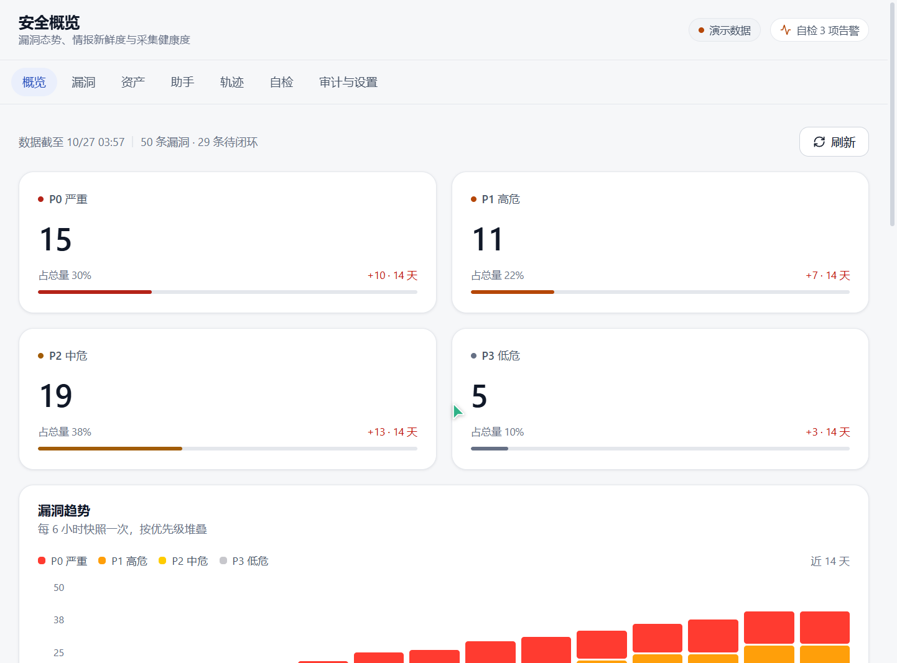
</p>

Signal 是一个面向主机与软件组件的**漏洞运营控制面**：Agent 采集 SBOM 与运行遥测，控制面完成 CVE/EPSS/KEV/OSV 匹配、可解释的风险排序、工单闭环与复扫验证；在此之上提供受控的 Agent 助手，把「看数据」延伸到「安全地做操作」。

- **单二进制交付**：Go 编译产物内含控制面、采集器、Agent、CLI 与迁移脚本，前端构建产物由同一进程托管。
- **可解释的风险排序**：CVSS × EPSS × 在野利用 × 资产权重，每一分都能在详情页拆解。
- **默认安全**：写操作必须经过会话审批模式与多重闸门，高风险再认证，一次性审批按参数指纹绑定，全程留痕。
- **能落地的助手**：34 个静态注册工具 + `/` 技能调用，只读诊断直接执行，变更操作走审批。
- **可观测与可加速**：SSH 主机性能曲线、服务加速能力探测、hashcat CPU/GPU 对比与基线前后差异一屏可见；上下文按预算分级压缩。

---

## 2026-11 重大更新

- **网页运行配置**：设置页新增「运行配置」，`.env` 中的 AI/GPU 端点、模型、同步与复扫周期、情报源、会话与 Cookie 安全项可直接在网页调节；密钥加密存储、不回显，修改写审计。
- **分级权限**：管理员可改全部配置；运维只能调整模型名称与上下文预算；只读角色仅查看。标注「重启后生效」的项会在保存后提示。
- **项目与集群**：新增「项目 → 集群 → 节点」模型，支持一个项目下管理多个集群，节点可标注后端、数据库、缓存、代理、存储或扫描目标。
- **分布式运维**：控制面在 A、后端在 B、数据库在 C 的场景下，可分别做 HTTP 健康检查、TCP 端口检查、SSH 连接检查与 SQLite 文件/分区检查。
- **跨主机漏洞扫描**：关联已保存 SSH 主机的节点可一键只读扫描，资产与漏洞自动进入流水线并归入所属集群；已有资产也可批量关联/解除关联。
- **异步检查与扫描**：整集群检查/扫描改为后台任务，3 个节点并发执行，页面实时显示进度与逐节点结果，支持取消；服务重启后未完成任务自动标记中断。
- **数据库深度检查**：数据库节点可配置只读账号，直接读取 MySQL / PostgreSQL 版本、当前连接数、最大连接数、数据容量与运行时长；密码使用 AES-256-GCM 加密存储且不回显。
- **集群闭环**：项目与集群支持编辑；集群资产、未关闭漏洞与 P0–P3 分布可直接跳转到带集群范围的资产/漏洞清单，列表与报告均支持 `clusterId` 筛选。
- **多 Agent 身份**：新增一次性注册令牌（绑定项目/集群、默认 60 分钟有效），每台主机换取独立 Agent ID 与密钥并保存本机身份；控制台展示在线状态、心跳与命令历史，支持下发 `ping` / `collect`，旧版全局令牌保持兼容。
- **硬件加速运行态**：服务加速探测与系统指标在同一 SSH 连接并发采集；新增温度、功耗、风扇、P-State、MIG 与 GPU 计算进程，并提供 3 秒缓存的轻量实时接口与页面 5 秒轮询。
- **集群 / 终端 / Agent 联动**：节点可直接新建 SSH 凭据并在终端打开；终端主机列表显示项目/集群归属；Agent 先调用 `list_clusters`/`check_cluster` 检查集群状态，再执行后续主机操作。
- **迁移**：新增 `0021_app_settings`、`0022_projects_clusters`、`0023_cluster_jobs`、`0024_cluster_db_checks`、`0025_agents`，既有资产与漏洞数据不受影响（`assets.cluster_id` 默认 0）。

---

## 版本与路线图

- 当前里程碑：`v0.7.3`（源码内开发版标识 `0.7.3-dev`）。
- [版本更新日志](docs/CHANGELOG.md)：逐个版本说明新增/修复/迁移，并标注提交区间与已推送的 `origin/master` 终点。
- [Roadmap](docs/ROADMAP.md)：`v0.8.0` 生产可用性、`v0.9.0` 分布式与规模化、`v1.0.0` 产品化与稳定契约。

---

## 目录

- [界面预览](#界面预览)
- [版本与路线图](#版本与路线图)
- [核心能力](#核心能力)
- [架构](#架构)
- [快速开始](#快速开始)
- [配置](#配置)
- [受控执行与安全模型](#受控执行与安全模型)
- [SSH 智能终端](#ssh-智能终端)
- [项目与集群](#项目与集群)
- [Agent 管理](#agent-管理)
- [运行配置](#运行配置)
- [运维技能](#运维技能)
- [目录结构](#目录结构)
- [测试与质量](#测试与质量)
- [部署](#部署)
- [文档](#文档)
- [许可证](#许可证)
- [已知边界](#已知边界)

---

## 界面预览

> 概览、漏洞、资产、助手截图使用演示数据（`VA_SEED_DEMO=on`）；自检与审计截图来自本机真实运行数据；SSH 终端截图连接的是本地测试 SSH 服务。截图中的「演示数据」标识会随模式自动出现/隐藏。
> 截图为早期版本，项目集群、Agent 管理、GPU 实时运行态等新增页面以当前版本实际界面为准。

**安全概览**：P0–P3 分布、14 天趋势、情报新鲜度与采集健康度一屏可见。


**漏洞清单**：按风险分排序，优先级、组件、修复版本、状态与责任人同屏；支持搜索、优先级/状态筛选与 CSV/PDF 导出。

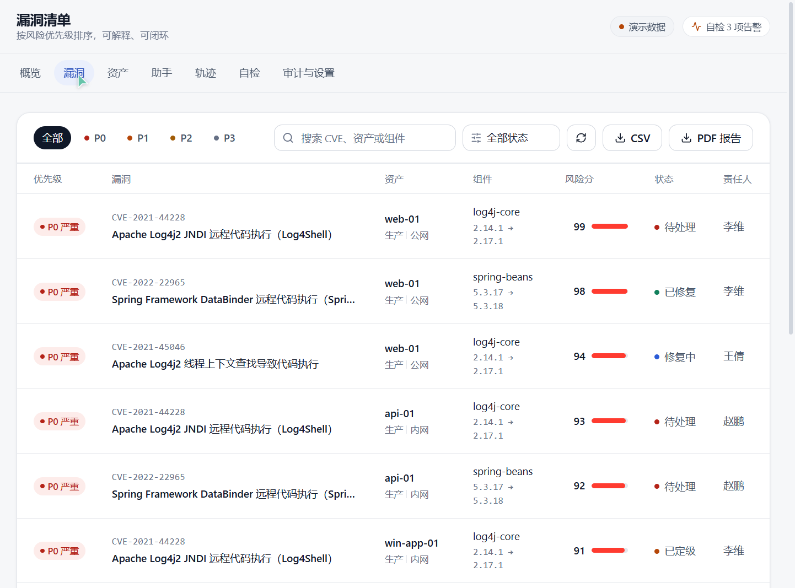

**资产详情**：主机画像、暴露面与组件清单，CPE 映射与关联漏洞逐项可查。

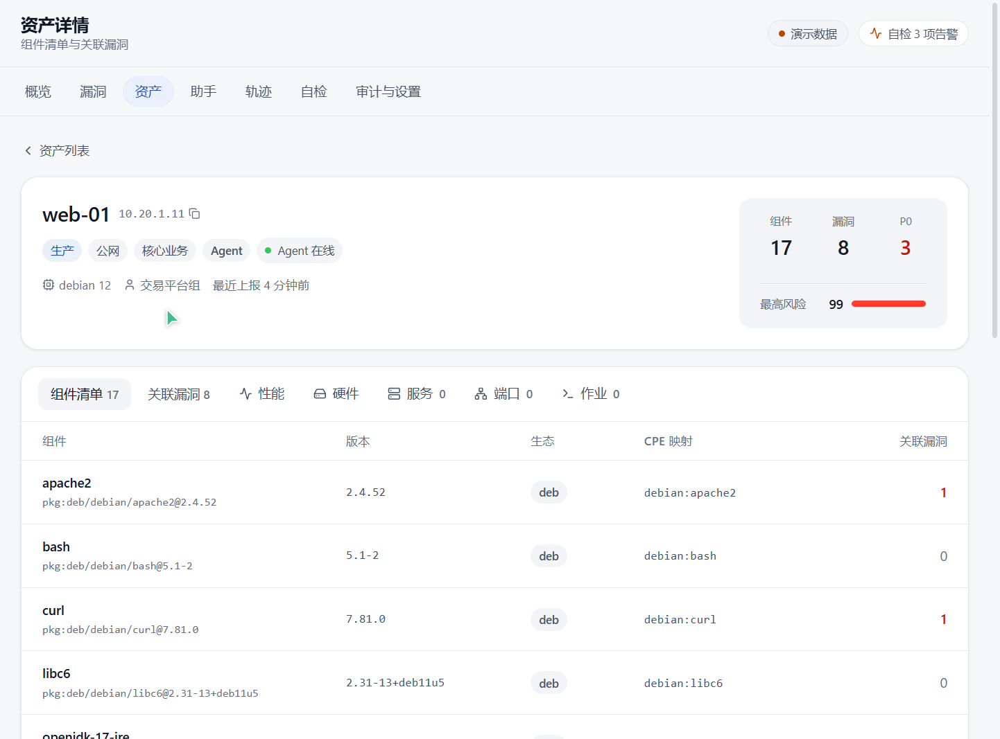

**Agent 助手**：工具调用自动聚合折叠，回答带引用依据；输入 `/` 可调用运维技能，写操作在输入框上方审批。

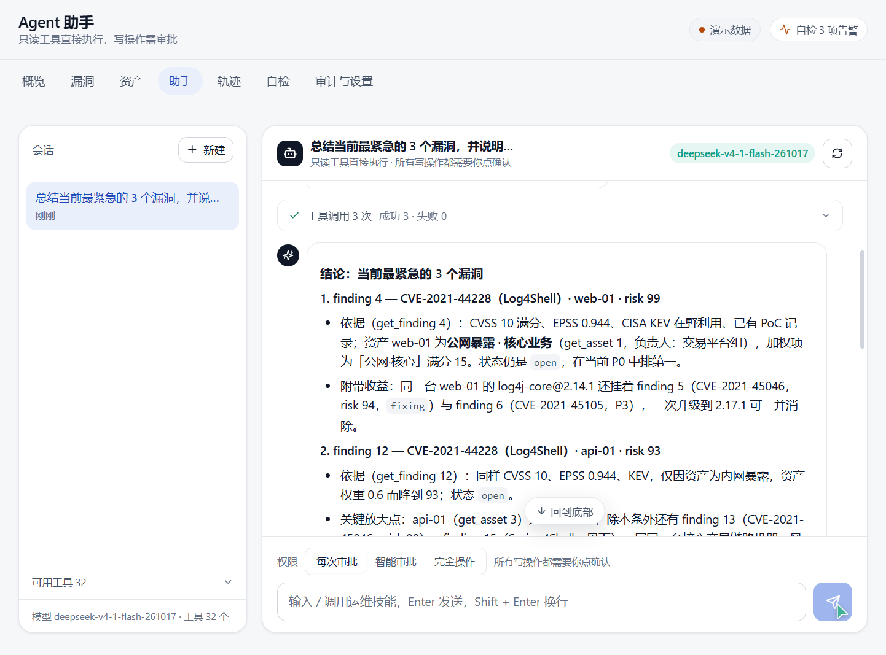

**SSH 智能终端**：多标签会话直连远端 PTY，连接状态、主机指纹与会话号一栏可见。

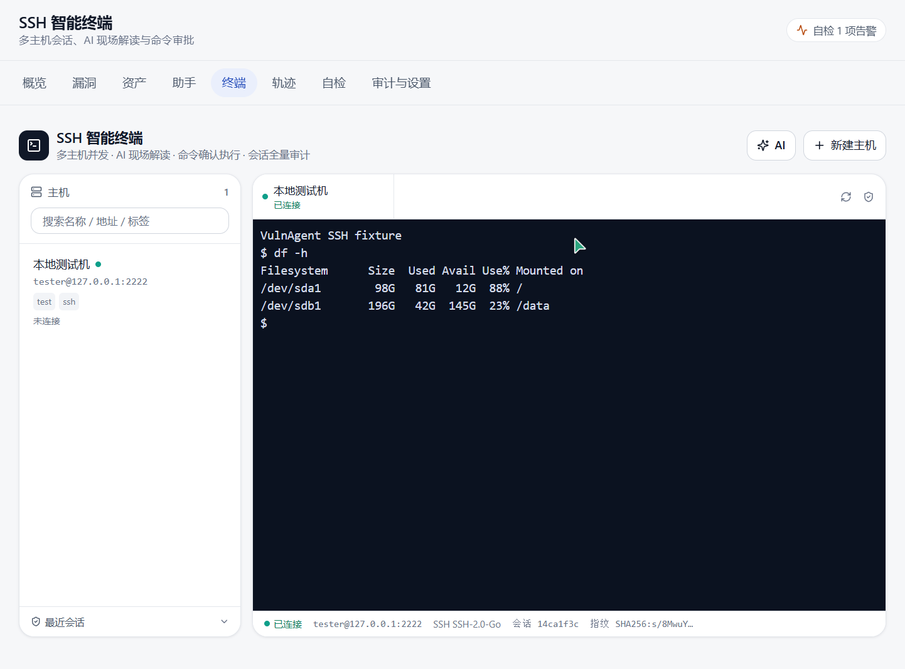

**AI 终端助手**：读取最近终端输出并结合主机信息回答，生成的命令默认只插入，执行前需要二次确认。

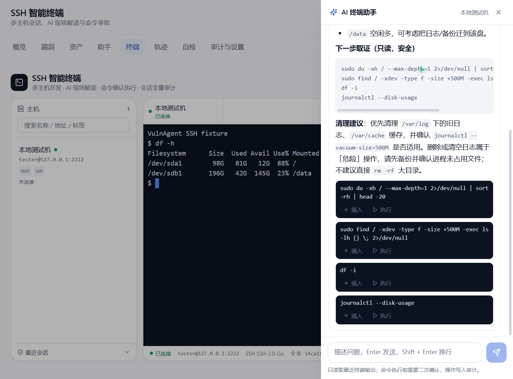

**Agent 自动执行**：目标被拆解为多步命令，逐步读取输出继续推理；危险命令按模式暂停等待人工确认。

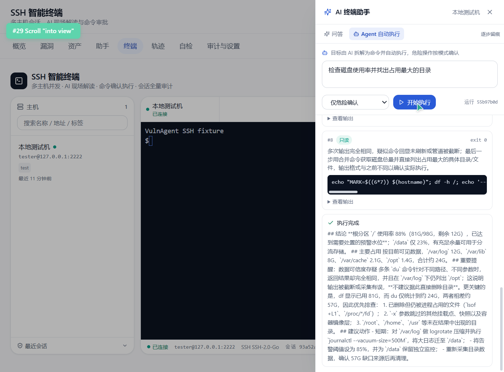

**Agent 命令审批**：逐条确认模式下，每条命令执行前都等待批准，批准后继续并展示输出与退出码。

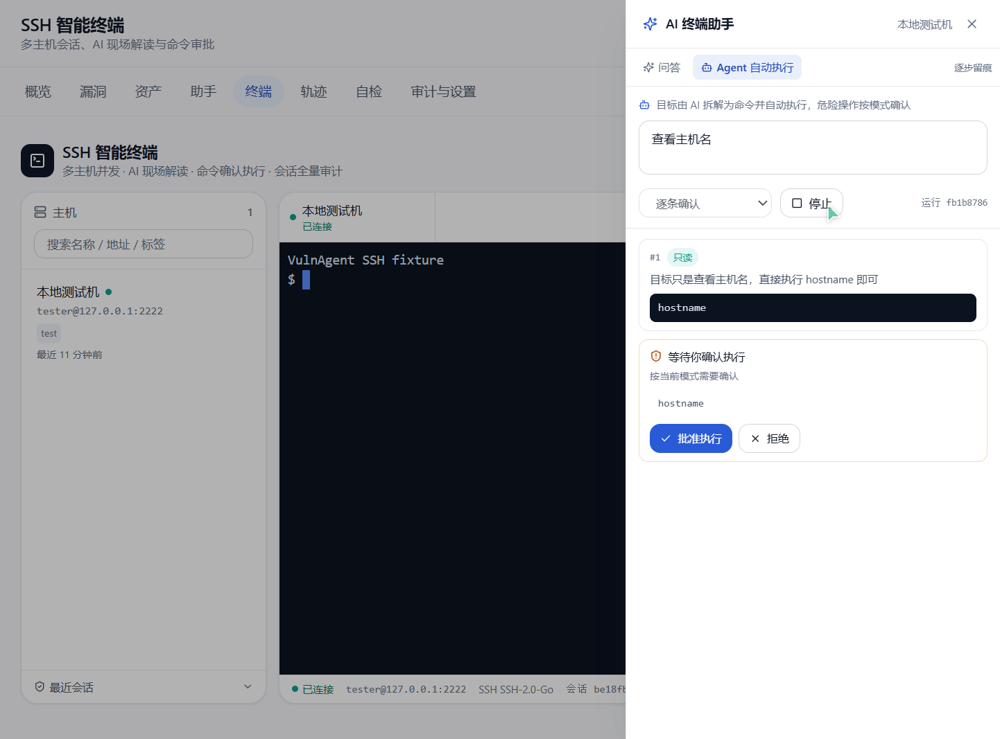

**平台自检**：数据库、情报同步、采集链路与平台自身共 16 项检查，失败项给出可执行建议。

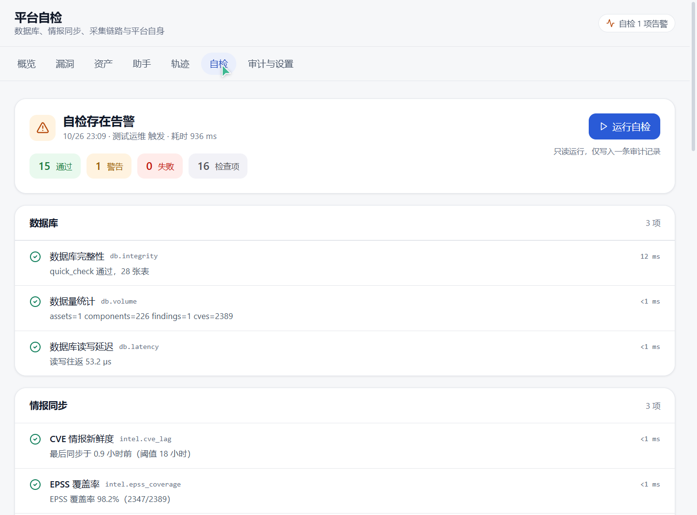

**审计日志**：支持关键字、操作人、动作与时间范围筛选，登录、扫描、导出、策略调整与审批全部留痕。

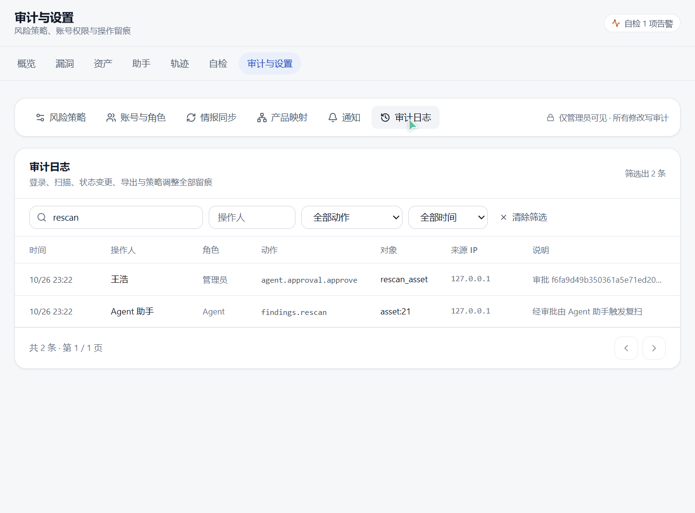

---

## 核心能力

| 能力 | 说明 |
| --- | --- |
| 资产与 SBOM | Windows（注册表 / CIM）与 Linux（dpkg / rpm / 语言生态）采集，覆盖系统包与 npm、pip、maven 等语言依赖 |
| 资产 CMDB | 业务系统、部门、责任人、机房、云厂商/实例、MAC/序列号等档案字段；标签、多来源标识、CSV 导入导出（先预览后写入）、逐字段变更历史与重复资产合并 |
| 资产发现 | 授权 CIDR 内 TCP 探活 + 反向 DNS，任务进度与取消；候选按「新发现 / 疑似已有」审核，一键入库或合并，拒绝越权网段并写审计 |
| 资产拓扑 | 业务系统 → 资产两列拓扑，展示依赖 / 运行于 / 成员 / 管理关系，支持业务系统与环境筛选 |
| 资产治理 | 责任人缺失、长期未上报、疑似重复、暴露面变化四类待办；批量分配责任人与归档 |
| 风险联动 | 业务系统重要性（核心 / 重要 / 一般）参与资产权重，管理员调整后即时重算漏洞风险分 |
| 云与 CMDB 集成 | 阿里云 ECS / AWS EC2 / Azure VM 只读同步与外部 CMDB JSON API 拉取；按标识归并、凭据加密，支持连接测试、手动与定时同步 |
| 漏洞匹配 | CVE 库 + OSV 在线精确版本匹配 + 内置产品映射；无法安装 Agent 时可用 SSH 只读兜底采集 |
| 风险排序 | CVSS、EPSS、CISA KEV、POC、资产暴露面与业务权重加权，输出风险分与 P0–P3 |
| 处置闭环 | 状态流转、责任人、本地工单、复扫验证（升级到修复版本自动转「已验证」） |
| 情报同步 | CVE/POC 默认每 12 小时增量同步；EPSS 支持全量导入与在线刷新；自检阈值随同步周期联动 |
| 主机遥测 | CPU、内存、磁盘、网络、负载、进程数，内存占用 Top10 进程，硬件/服务/端口清单 |
| 主机性能监控 | SSH 只读实时采样 CPU、内存、Swap、负载、磁盘、网络与 Top 进程，曲线 + 表格，支持 2/3/5/10 秒轮询与暂停 |
| 项目与集群 | 项目下管理多个集群；节点标注后端/数据库/缓存/代理/存储/扫描目标，支持 HTTP/TCP/SSH/SQLite 文件检查、异步检查/扫描与跨集群资产/漏洞跳转 |
| 数据库深检 | MySQL / PostgreSQL 只读连接，读取版本、连接数、容量与运行时长；凭据加密存储、不回显 |
| Agent 管理 | 一次性注册令牌、单机身份（Agent ID + 密钥）、心跳在线状态、项目/集群归属与 `ping`/`collect` 命令通道 |
| 运行配置 | 网页调节 AI/GPU 端点、模型、上下文预算、同步与复扫周期、情报源与安全项；密钥加密、按角色分级、修改写审计 |
| 服务加速 | 按主机检测 NVIDIA GPU/CUDA/持久化模式/功耗/频率/温度/风扇/P-State/MIG 与 GPU 进程，实时轮询运行态；记录基线后对比加速前后指标；hashcat CPU/GPU 基准与批量口令审计 |
| 上下文压缩 | Agent 与问答按 token 预算分级压缩历史与输出，SSE/响应返回占用统计，前端展示占用条与已压缩项 |
| 主机作业 | Agent 拉取模型、HMAC-SHA256 签名、幂等键、指数退避、同资产并发闸门 |
| Agent 助手 | OpenAI 兼容模型接入，SSE 流式返回，34 个静态工具按角色裁剪；支持 GPU 推理端点按主机切换 |
| SSH 智能终端 | 多主机会话、AES-256-GCM 加密凭据、TOFU 指纹校验、WebSocket 终端、AI 问答与命令参考检索、Agent 自动执行与运行历史、SFTP、会话录制回放、快捷命令广播、会话协同、主机漏洞扫描 |
| 运维技能 | `skill/*.zip` 启动解压，`/` 菜单调用，技能文档分页读取，语义化主机诊断 |
| 审计与轨迹 | 审计日志多维筛选；轨迹页统一呈现审计、主机作业与工具调用 |
| 通知 | 飞书 Webhook，支持新漏洞、建单、同步失败、自检失败、资产新增/更新/合并与集成同步失败等事件 |

---

## 架构

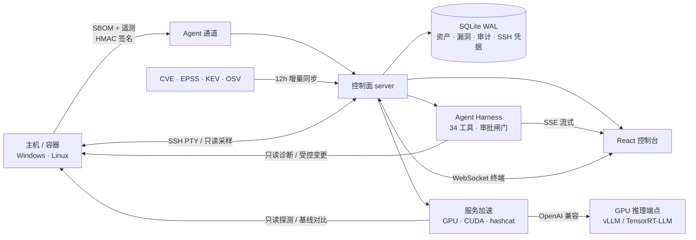

服务端按 DDD 四层组织，`package main` 只做组装：

| 层 | 职责 |
| --- | --- |
| `internal/domain` | 资产、漏洞、风险、身份、Harness 等领域模型与策略 |
| `internal/application` | 用例、仓储端口、扫描流程与 Agent Harness |
| `internal/infrastructure` | SQLite 仓储、OpenAI 兼容模型、SSH 扫描等实现 |
| `internal/platform` | 配置（`.env` 自动加载）、时钟等平台能力 |

---

## 快速开始

**前置**：Go 1.26+、Node.js 20+（仅前端开发需要）。

```powershell
# 1) 构建控制面（Windows；Linux/macOS 将输出名换成 vulnagent 即可）
cd server
go build -o bin\vulnagent.exe .

# 2) 准备配置：程序会自动加载当前目录或上级目录的 .env
#    生产模式至少设置 VA_ADMIN_PASSWORD；演示模式可跳过
Copy-Item ..\deploy\systemd\server.env.example ..\.env

# 3) 启动控制面（默认 :8787）
.\bin\vulnagent.exe server
```

打开 <http://127.0.0.1:8787/>，用初始化时设置的管理员账号登录。

**接入主机 Agent**（采集 SBOM、遥测并执行主机作业）：

```powershell
# 推荐：在「Agent 管理」生成一次性注册令牌后，在目标主机执行
.\bin\vulnagent.exe agent --server http://127.0.0.1:8787 --enroll-token <一次性令牌> --watch

# 兼容方式：使用全局 Agent 令牌
.\bin\vulnagent.exe agent --server http://127.0.0.1:8787 --watch --interval 5s
```

注册令牌仅可使用一次，首次运行会换取 Agent ID 与密钥并写入 `<数据目录>/agent.identity.json`（0600），后续启动无需再次输入。全局令牌来源优先级：`--token` > `--token-file` > `VA_AGENT_TOKEN` > `<数据目录>/agent.token`。

**前端开发**：

```powershell
cd web
npm install
npm run dev      # http://localhost:5173，/api 代理到 127.0.0.1:8787
npm run build    # tsc --noEmit + vite build，产物在 web/dist
```

**演示模式**：设置 `VA_SEED_DEMO=on` 会灌入 12 台资产、29 条 CVE 与 50 条漏洞，并创建三个演示账号（仅限本地体验，请勿用于生产）：

| 账号 | 口令 | 角色 |
| --- | --- | --- |
| `admin` | `Admin@12345` | 管理员 |
| `operator` | `Ops@12345` | 运维 |
| `viewer` | `View@12345` | 只读 |

---

## 配置

配置默认来自环境变量与 `.env`；常用项可在设置页「运行配置」覆盖，优先级为 **网页保存值 > 环境变量/.env > 默认值**。已存在的环境变量优先于 `.env` 文件。

| 变量 | 默认值 | 说明 |
| --- | --- | --- |
| `VA_ADDR` | `:8787` | 控制面监听地址 |
| `VA_DATA_DIR` | `./data` | 数据目录：SQLite、Agent 令牌/身份、SSH 密钥与备份 |
| `VA_SEED_DEMO` | `off` | `on` 时灌入演示数据并创建演示账号 |
| `VA_ADMIN_PASSWORD` | — | 生产模式首次启动初始化 admin 的口令（≥10 位，含字母与数字） |
| `VA_AGENT_TOKEN` | 自动生成 | 全局 Agent 接入令牌；缺省时生成并写入 `<数据目录>/agent.token`。单机 Agent 可改用一次性注册令牌换取独立身份 |
| `VA_SSH_KEY` | 自动生成 | SSH 凭据加密密钥（32 字节 base64）；缺省时生成 `<数据目录>/ssh.key` |
| `VA_SESSION_IDLE` | `30m` | 登录会话空闲过期时长 |
| `VA_COOKIE_SECURE` | `off` | HTTPS 部署时置 `1`，Cookie 增加 `Secure` |
| `VA_LLM_BASE_URL` | — | OpenAI 兼容模型地址 |
| `VA_LLM_API_KEY` | — | 模型密钥 |
| `VA_LLM_MODEL` | — | 模型名称；三项齐备才启用助手 |
| `VA_GPU_LLM_BASE_URL` | — | GPU 推理端点（OpenAI 兼容，如 vLLM）；与 `VA_GPU_LLM_MODEL` 齐备即启用 |
| `VA_GPU_LLM_API_KEY` | — | GPU 推理端点密钥；本地服务可留空，服务端使用占位值 `local` |
| `VA_GPU_LLM_MODEL` | — | GPU 推理模型名称 |
| `VA_AGENT_CONTEXT_BUDGET` | `16000` | Agent/问答上下文 token 预算（4000–128000） |
| `VA_SYNC_INTERVAL` | `12h` | CVE/POC 增量同步周期，`0`/`off` 关闭 |
| `VA_RESCAN_INTERVAL` | `30m` | 定时复扫周期 |
| `VA_RESCAN_DEBOUNCE` | `10m` | 同一资产复扫的最小间隔 |
| `VA_ENV_FILE` | `.env` → `../.env` | 显式指定 `.env` 路径 |
| `VA_EPSS_URL` | FIRST 官方地址 | EPSS 全量评分源 |
| `VA_OSV_URL` | OSV 官方接口 | 语言生态版本匹配接口 |
| `VULNAGENT_CVE_BASE_URL` | `https://cve.imfht.com` | CVE 情报源 |

---

## 受控执行与安全模型

助手的每个工具调用都会依次经过：工具静态注册校验 → 参数 JSON 与大小限制 → 角色最小权限 → 会话调用频率 → 审批模式判定 → 参数指纹与一次性消费 → 高风险口令再认证。

| 风险级别 | 行为 |
| --- | --- |
| 只读（low） | 直接执行，结果进入工具调用记录 |
| 写操作（medium） | 按会话权限模式处理，默认需要人工批准 |
| 高风险（high） | 人工批准 + 当前账号口令再认证 |

会话级权限模式（切换即时生效并写入审计）：

- **每次审批**：所有写操作都等待人工点击确认。
- **智能审批**：由同一模型判断是否可自动执行，拿不准一律转人工。
- **完全操作**：写操作自动执行，工具调用与操作轨迹完整留痕（`approver=auto:full`）。

审批记录 10 分钟有效、一次性消费，并与工具名 + 参数 SHA-256 绑定；参数变化即失效。命令执行侧另有 argv 白名单、Windows 只读命令严格校验、路径白名单、原子写与快照机制。

SSH 面板的登录凭据使用 AES-256-GCM 加密保存在数据目录，密钥文件 `ssh.key` 首次使用时自动生成（0600）；首次连接采用 TOFU 记录主机 SHA256 指纹，后续指纹变化会直接拒绝连接；连接、断开、终端输入与 AI 提问全部写入审计。

---

## SSH 智能终端

- **主机凭据集中管理**：支持口令与私钥（含私钥口令），AES-256-GCM 加密落盘，接口永不回显明文。
- **WebSocket 终端**：浏览器通过 xterm.js 渲染，后端桥接 SSH PTY；窗口尺寸变化实时同步，支持多标签并行会话。
- **主机指纹 TOFU**：首次连接记录 SHA256 指纹，之后指纹不一致直接阻断；可在主机编辑中清除并重新信任。
- **AI 现场助手**：读取最近 8KB 终端输出与主机信息，给出结论、排查步骤和可执行命令；支持多轮对话（自动携带本会话最近 8 条消息），命令默认只「插入」终端，点击「执行」还需二次确认。
- **Agent 自动执行**：给定自然语言目标后，Agent 会先做只读侦察，再根据输出决定下一步，最多 8 步；达到上限时自动生成收尾结论。
  - 单步 JSON 解析失败会自动修复（尾逗号、中文引号、围栏、前后解释）并让模型重写；连续失败时保留已执行步骤并优雅结束，不再中断整个任务。
  - 同一主机的最近 3 次已完成任务会自动作为上下文注入，避免重复侦察。
  - **仅危险确认**（默认）：只读命令直接执行，高风险与 critical 命令暂停等待确认。
  - **逐条确认**：每条命令执行前都需要人工批准。
  - **全自动**：其余命令直接执行，critical 命令仍需确认。
  - critical 判定覆盖 `rm -rf /`、`mkfs`、`dd of=/dev/*`、关机重启、磁盘分区等破坏性操作；命令风险、审批人、输出与退出码全部留痕。
- **会话录制与回放**：终端输出按时间偏移异步落库（单会话上限 2MB），在「最近会话」中可回放，支持暂停、重播与 1x/2x/4x 变速，复盘现场不依赖远端环境。
- **快捷命令与广播**：团队共享脚本库支持新建、编辑、删除、插入、单机执行与「广播到全部已连接会话」；底部快捷命令栏可直接输入并一键广播，使用次数与变更写入审计。
- **命令参考联网检索**：AI 问答与 Agent 自动执行均有独立的「联网检索命令参考」开关；按问题/目标检索 cheat.sh 的命令示例（tar/df/ss/lastb 等），清洗后注入模型并要求先用 `command -v` / `--help` 验证；本地关键词无法判断时由模型提取命令主题，失败自动回退到模型知识。
- **SSH 主机漏洞扫描**：已保存的主机可一键触发只读软件清单采集，结果直接进入资产与漏洞流水线；结果弹窗展示组件数与新增/更新漏洞，可跳转资产详情。
- **实时性能监控**：终端顶部「性能监控」跳转主机监控页，展示 CPU/内存/负载/网络曲线、磁盘与 Top 进程表，支持 2/3/5/10 秒轮询、暂停与立即刷新。
- **服务加速**：终端顶部「服务加速」检测 NVIDIA GPU、CUDA、持久化模式、功耗/频率、CPU 调频与 hashcat 状态，给出只读调优建议；记录基线后可对比加速前后 CPU/内存/负载/GPU 指标。hashcat 可用时提供 CPU/GPU 基准与批量字典审计（仅 operator，临时文件自动清理）。
- **上下文占用**：Agent 每一步通过 SSE `context` 事件返回已用/预算 token、压缩项与节省量，问答响应同样返回；面板显示占用条（≥70% 黄色、≥90% 红色），预算由 `VA_AGENT_CONTEXT_BUDGET` 控制。
- **连接复用**：性能监控、服务加速、GPU 探测与 hashcat 共用只读 SSH 连接池，空闲 3 分钟回收，避免高频轮询重复握手。
- **布局与路径**：主机栏与 AI 面板均可折叠并记忆状态，为终端与输入框释放空间；文件管理支持复制当前路径、条目路径与预览文件路径。
- **会话协同**：为在线会话生成一次性分享链接（只读 / 可写，5 分钟–24 小时有效），协作者登录后即可实时观看或共同操作；新加入者自动补齐最近 16KB 输出，协作者人数实时同步，链接可随时撤销。
- **终端检索**：终端内 `Ctrl/Cmd + F` 唤起搜索框，Enter / Shift+Enter 上下跳转，Esc 关闭。
- **Agent 运行历史**：每次自动执行的模式、步骤、命令、输出与收尾结论可事后查看，并支持一键复用目标。
- **文件管理（SFTP）**：终端页右侧抽屉直接浏览远端目录，支持上传（单文件 256MB）、下载、新建目录、重命名、删除（目录需递归确认）与在线预览编辑（文本 256KB 内可直接保存，二进制自动提示下载）；路径可输入跳转或面包屑导航，全部操作写入审计。
- **全量审计**：连接/断开、用户输入命令、AI 提问、Agent 每一步命令与审批结果、文件读写都会进入审计日志与操作轨迹。

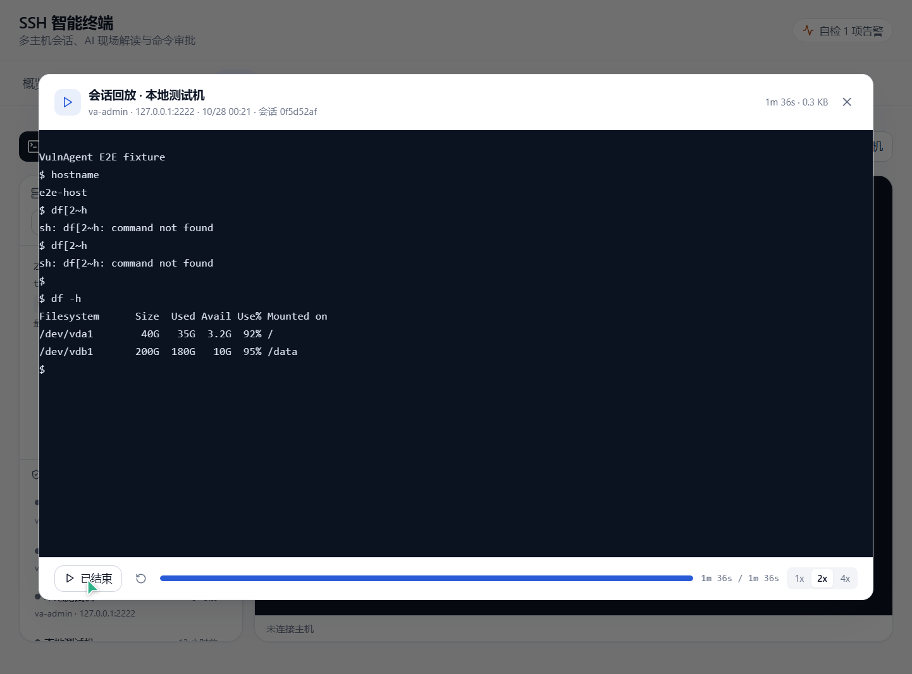

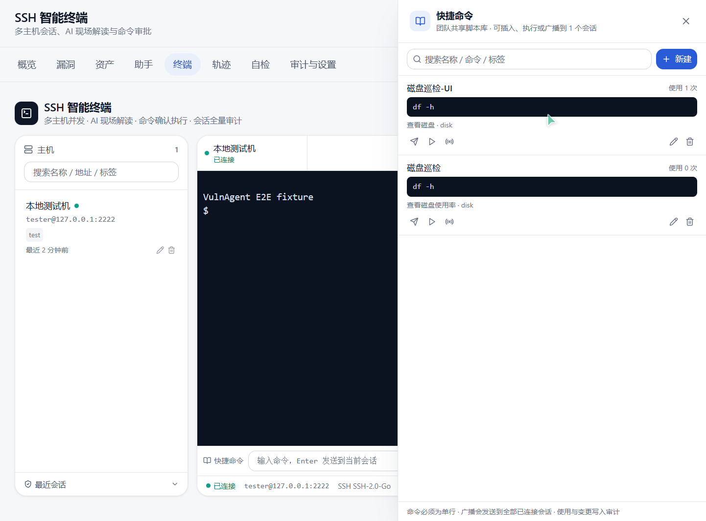

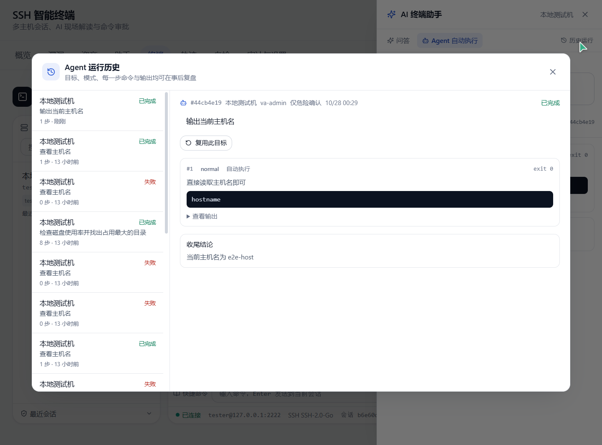

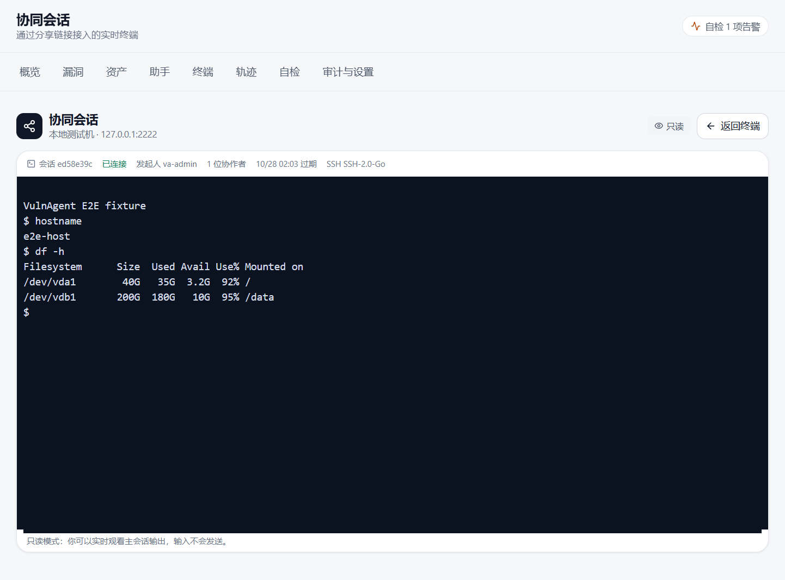

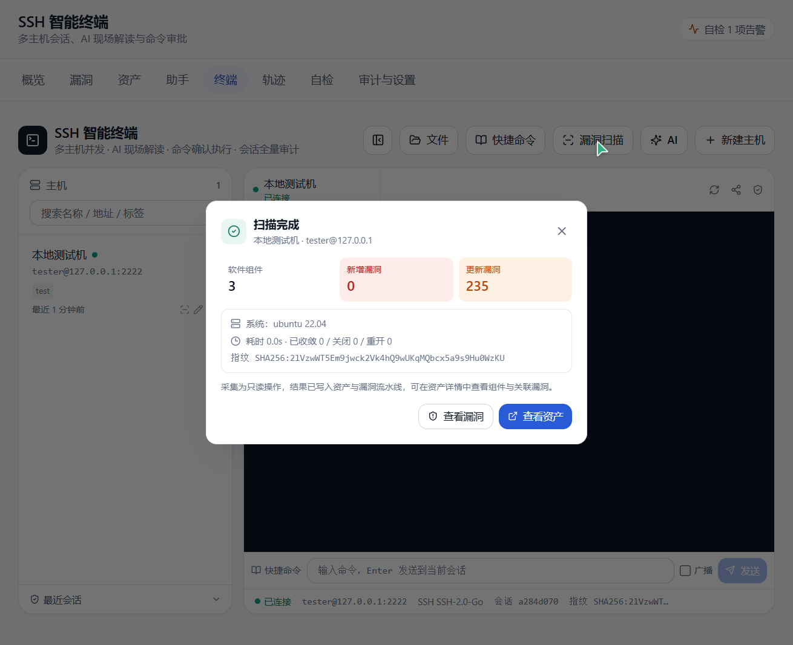

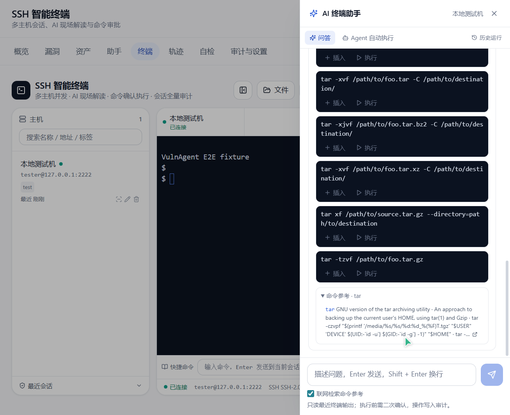

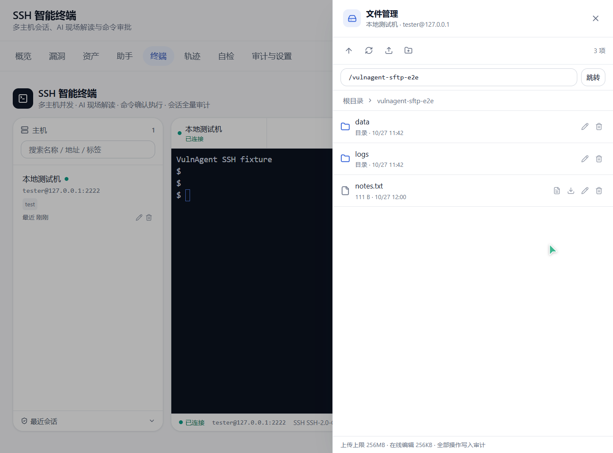

---

## 项目与集群

适用于控制面、业务后端、数据库与目标资产分处不同主机的场景：

- **项目**：按业务系统或团队聚合；一个项目可包含多个集群。
- **集群**：按环境（生产/预发/开发/测试）与云厂商/地域划分。
- **节点角色**：后端服务、数据库、缓存、代理/网关、存储、扫描目标。
- **健康检查**：
  - 后端：HTTP 请求健康地址（默认 `/api/v1/healthz`）；服务端口填 8787 等 HTTP 端口，不要填 SSH 的 22。
  - 数据库/缓存/代理：TCP 端口连通性。
  - 数据库深检（可选）：配置 MySQL / PostgreSQL 只读账号后，额外读取版本、当前/最大连接数、数据容量与运行时长。
  - SQLite 数据库：关联 SSH 主机后检查文件大小与分区使用率。
  - 扫描目标：复用 SSH 主机凭据检查连接与命令执行。
- **SSH 凭据**：节点表单可直接选择已保存的 SSH 主机，也可勾选「直接填写用户名和密码新建」，保存时自动创建终端主机凭据并关联；节点不保存明文密码。
- **终端联动**：节点行提供「在 SSH 终端打开」按钮，跳转 `/terminal?hostId=…` 自动建立会话；终端主机列表显示所属项目/集群，可按名称筛选。
- **异步执行**：「检查全部」「扫描全部」创建后台任务，3 个节点并发执行；页面轮询显示进度、逐节点结果与耗时，可随时取消；服务重启后未完成任务标记为中断。
- **漏洞扫描**：关联 SSH 主机的节点可单点或整集群执行只读软件清单采集，结果进入现有资产/漏洞流水线，并自动归入集群；已有 Agent 资产可批量关联。
- **跨页闭环**：集群的关联资产、未关闭漏洞与 P0–P3 分布可直接跳转到带 `clusterId` 的资产/漏洞清单；列表与 PDF/CSV 报告沿用同一筛选。
- **权限**：项目/集群创建删除仅管理员；编辑、节点、检查、扫描、资产关联、数据库凭据为运维及以上；查看为只读及以上。数据库密码加密存储且接口不回显。
- **典型流程**：创建项目 → 创建集群 → 添加节点（可选配置数据库只读连接）→ 检查全部 → 扫描全部 → 在集群详情查看资产与 P0–P3 漏洞分布。

详细设计见 [多集群与项目运维设计](docs/architecture/multi-cluster-design.md)。

---

## Agent 管理

面向「每台主机自行部署 Agent」的场景，避免所有主机共用同一个全局令牌：

- **一次性注册令牌**：运维在页面生成，可绑定项目/集群、设置有效期（默认 60 分钟，最长 24 小时）；令牌只显示一次，使用后立即失效。
- **单机身份**：Agent 首次运行用注册令牌换取 `Agent ID + 密钥`，保存为 `<数据目录>/agent.identity.json`（0600）；后续上报、拉取作业与命令均使用该身份，支持单独吊销。
- **在线状态**：Agent 每 15 秒发送心跳，页面按最近 3 分钟判断在线/离线；展示主机名、IP、系统、版本与最近心跳时间。
- **双向命令**：控制台可下发 `ping` 与 `collect`（立即重新采集并上报），Agent 拉取执行后回传输出与状态，页面保留命令历史。
- **资产归集**：注册令牌绑定集群后，该 Agent 上报的资产自动写入 `assets.cluster_id`。
- **集群优先**：助手涉及集群、节点或主机操作时，必须先调用 `list_clusters` 查看状态；需要实时结果时调用 `check_cluster` 做只读检查，确认异常节点与原因后才继续执行后续操作。
- **兼容性**：未注册的旧 Agent 继续使用全局 `VA_AGENT_TOKEN` / `agent.token`，作业签名与拉取流程不变。

---

## 运行配置

设置页「运行配置」把常用 `.env` 项搬到网页，优先级为 **网页保存值 > 环境变量/.env > 默认值**：

| 分组 | 配置项 | 可修改角色 | 生效方式 |
|---|---|---|---|
| AI 模型 | 模型地址、密钥、模型名称、上下文预算 | 端点/密钥 admin；模型名称与上下文预算 operator | 重启后生效 |
| GPU 推理 | GPU 端点、密钥、模型名称 | admin | 重启后生效 |
| 情报与扫描 | 同步周期、复扫周期/最小间隔、CVE/EPSS/OSV 地址 | admin | 周期需重启；地址即时 |
| 安全 | 会话空闲过期、Secure Cookie | admin | 即时 |

密钥使用 AES-256-GCM 加密存储，接口只返回“是否已设置”，不会回显明文；所有修改写审计但不记录值。标注「重启后生效」的项保存后会在页面提示。

---

## 运维技能

将技能包放在仓库根目录 `skill/*.zip`，服务启动时解压到 `skills/` 并解析 `SKILL.md` front matter（同 id 保留最高版本）。在助手输入框输入 `/` 即可选择技能，技能上下文仅注入一次，Agent 可通过 `list_skill_files` / `read_skill_file` 按需分页读取文档，并用 `host_diagnose` 执行语义化的只读诊断（覆盖磁盘、内存、网络、服务、日志、证书、容器等常见排障场景）。

仓库内置两个示例技能：

- `tencentos-expert`：TencentOS / Linux 全栈运维诊断
- `winskill`：Windows 主机运维与排障

---

## 目录结构

```text
.
├── server/                     # Go 控制面与 CLI（单二进制）
│   ├── internal/
│   │   ├── domain/             # 领域模型与策略
│   │   ├── application/        # 用例、端口、Agent Harness
│   │   ├── infrastructure/     # SQLite、模型、SSH 等实现
│   │   └── platform/           # 配置、时钟
│   ├── assets/fonts/           # PDF 中文字体
│   └── bin/                    # 构建产物
├── web/                        # React 控制台（Vite + TypeScript + Tailwind）
├── skill/                      # 技能 zip 分发包
├── skills/                     # 解压后的技能目录（gitignored）
├── docs/                       # 架构、API 契约、ADRs、版本日志、Roadmap、截图
├── deploy/                     # systemd / Windows / 容器部署脚本
└── Dockerfile
```

服务端 CLI：

```text
vulnagent server                     启动控制面（默认 :8787）
vulnagent collect [--out sbom.json]  仅采集本机 SBOM，不联网
vulnagent agent --server <url>       采集并上报到控制面
vulnagent agent --server <url> --enroll-token <token> --watch  注册为单机 Agent 并常驻
vulnagent agent --server <url> --watch  使用全局令牌常驻拉取主机作业
vulnagent helper                     提权 helper
vulnagent sync --bundle <file>       导入离线情报包
vulnagent sync --epss-file <csv>     导入 EPSS 并重算排序
vulnagent sshscan --host <ip>        无 Agent 兜底采集（只读）
vulnagent osvscan [--asset id|--all] OSV 在线版本匹配
vulnagent backup --out <file>        备份数据库（VACUUM INTO，可加 --compress 生成 .db.gz）
vulnagent keygen / sign / self-update 签名与自更新
```

---

## 测试与质量

```powershell
# 后端：领域、Harness、执行器、SQLite 仓储、技能与诊断目录
cd server
go test ./...

# 前端：类型检查 + 生产构建
cd web
npm run build
```

测试覆盖重点：参数白名单校验、审批过期与一次性消费、风险评分与优先级、数据库迁移、技能解析与越界防护、诊断目录完整性、集群异步任务、数据库 DSN 构建与凭据加密、Agent 注册/心跳/命令生命周期。

---

## 部署

### 一键安装（推荐）

**Windows（PowerShell 7）**

```powershell
# 在仓库根目录执行；自动检查 Go/Node/端口/磁盘/网络，构建并安装
pwsh -File deploy\windows\install.ps1 -InstallDeps

# 可选：同时配置模型、GPU 推理端点、放行防火墙、自定义目录与端口
pwsh -File deploy\windows\install.ps1 `
  -InstallDir E:\VulnAgent -Port 8787 -OpenFirewall `
  -LLMBaseUrl https://ark.cn-beijing.volces.com/api/v3 `
  -LLMApiKey "<key>" -LLMModel deepseek-v4-1-flash-261017 `
  -GPUBaseUrl http://127.0.0.1:8000/v1 -GPUModel Qwen2.5-32B-Instruct
```

安装脚本会完成：环境与端口检查 → （可选）通过 winget 安装 Go/Node → `npm ci` 与 `go build` → 部署到安装目录 → 生成 `.env`（首次初始化管理员口令）→ 注册 `VulnAgentServer` / `VulnAgentAgent` 计划任务 → 健康检查 → 输出 `install-summary.txt`。
重复执行即为升级：保留数据与已有 `.env`，先停止旧实例并备份数据库。安装目录默认优先 `E:\VulnAgent`、`D:\VulnAgent`，避免占用系统盘。

**Linux（systemd）**

```bash
sudo bash deploy/linux/install.sh --install-deps
# 可选
sudo bash deploy/linux/install.sh --port 8787 --open-firewall \
  --llm-base-url https://ark.cn-beijing.volces.com/api/v3 \
  --llm-api-key "<key>" --llm-model deepseek-v4-1-flash-261017 \
  --gpu-base-url http://127.0.0.1:8000/v1 --gpu-model Qwen2.5-32B-Instruct
```

脚本会检查系统/磁盘/端口/外网，缺少 Go/Node 时从官方源下载校验后放入安装目录工具链，完成构建、创建 `vulnagent` 系统用户、写入 `/etc/vulnagent/server.env`（0600）、安装并启动 `vulnagent-server.service` 与本机 Agent，健康检查失败自动回滚上一版二进制。
配置、数据、日志分别位于 `/etc/vulnagent`、`/var/lib/vulnagent`、`/opt/vulnagent/logs`；运维脚本在 `/opt/vulnagent/scripts/`（status/start/stop/backup/uninstall）。

### 其他方式

- **systemd 手工部署**：`deploy/systemd/`（server / agent 服务单元、agent timer、helper sudoers 与 env 示例）
- **Kubernetes**：`deploy/k8s/`（server 与 agent CronJob 清单）
- **Windows 手工启动**：`deploy/windows/start-prod.ps1`
- **容器**：仓库根目录 `Dockerfile`

生产建议：`VA_SEED_DEMO=off`、设置强口令、HTTPS 前置并开启 `VA_COOKIE_SECURE=1`、定期 `vulnagent backup`。

---

## 文档

- [版本更新日志](docs/CHANGELOG.md)
- [Roadmap](docs/ROADMAP.md)
- [详细设计](docs/architecture/detailed-design.md)
- [API 契约](docs/architecture/api-contract.md)
- [多集群与项目运维设计](docs/architecture/multi-cluster-design.md)
- [CMDB 分页契约](docs/architecture/cmdb-pagination-contract.md)
- [架构决策记录](docs/architecture/adr/)
- [品牌与设计系统](docs/design/brand.md)
- [回归测试报告](docs/quality/test-report.md)
- [性能压测报告（2026-11-01，历史）](docs/reports/perf-benchmark-2026-11-01/perf-benchmark-2026-11-01.html)

---

## 许可证

本项目基于 [GNU General Public License v3.0](LICENSE) 发布，完整条款见 [LICENSE](LICENSE)。

Copyright (C) 2026 Signal 项目贡献者。你可以在遵守 GPL-3.0 条款的前提下使用、修改与再分发本项目；分发衍生作品时需同样以 GPL-3.0 开放源代码。

---

## 已知边界

- 控制面当前为单节点部署，SQLite（WAL）承载全部数据；多控制面与集中式存储尚未实现（已支持多集群、多 Agent 采集）。
- 漏洞情报依赖外部公开源，离线环境需通过 `vulnagent sync --bundle` 导入。
- Agent 助手需要可访问的 OpenAI 兼容模型服务；不可用时其余功能不受影响。
- SSH 面板目前为控制面直连目标主机，暂未支持跳板机与端口转发（OrcaTerm 的端口转发为客户端能力）；SFTP 为单文件串行传输，暂不支持目录打包上传与断点续传。
- 会话协同链接需登录控制台后使用；可写链接仅对 operator 及以上角色生效，viewer 打开可写链接会自动降级为只读。
- 命令参考检索依赖外网 `cheat.sh`，不可用时自动回退到模型知识并在界面提示；参考内容仅作为提示，执行前仍需用 `command -v` / `--help` 在目标机验证。
- SSH 主机扫描为只读采集，支持 deb/rpm/apk 发行版；非 Linux 或权限不足会返回明确错误。
- 资产 CMDB 当前支持手工编辑、Agent/SSH 自动登记、CSV 导入、授权网段发现与云厂商/外部 CMDB 只读同步；外部系统回写与双向同步尚未实现。
- 网段发现为 TCP 探活（不发送 ICMP、不发起 HTTP 请求），默认仅内网与回环网段；同一时间只允许一个任务，单任务主机数受策略限制。
- 资产权重 = 暴露面 × 资产业务等级 × 业务系统重要性；未在「业务系统重要性」中登记的业务系统按「一般」计算。
- 疑似重复仅按 IP / MAC / 序列号提示，不自动合并；拓扑最多展示 300 个节点，超出需按业务系统或环境筛选。
- 云厂商同步只读调用官方列表接口，需要控制面能出站访问对应云 API；未配置凭据时只能保存配置、无法测试或同步。
- 外部 CMDB 支持 GET JSON 与分页游标/多页同步（见 [CMDB 分页契约](docs/architecture/cmdb-pagination-contract.md)），不支持回写外部系统。
- 会话录制单会话上限 2MB，超出后标记截断；回放按输出时间偏移重放，不包含终端尺寸变化等非输出事件。
- Agent 自动执行依赖当前浏览器连接（SSE），关闭页面会中断运行；运行记录与步骤仍会保存在审计中。
- 服务加速为只读检测与建议，不会自动修改目标机；支持 60 秒能力缓存与 3 秒实时运行态缓存，基线对比反映采样时刻的 CPU/内存/负载/GPU 状态，不能替代压测。
- hashcat 审计需要目标机自行安装 hashcat 与字典；结果包含明文口令，仅限 operator 在授权资产上使用。
- GPU 推理加速需要可访问的 OpenAI 兼容本地端点；未配置时主机加速开关不生效。
- 备份压缩为多协程并行 gzip，未链接 CUDA/nvCOMP，因此不是 GPU 压缩；大库备份仍需预留与数据库同量级的磁盘空间。
- 上下文压缩为启发式估算（中文 1 字 1 token、其他 4 字符 1 token），实际 token 数以模型分词器为准。
